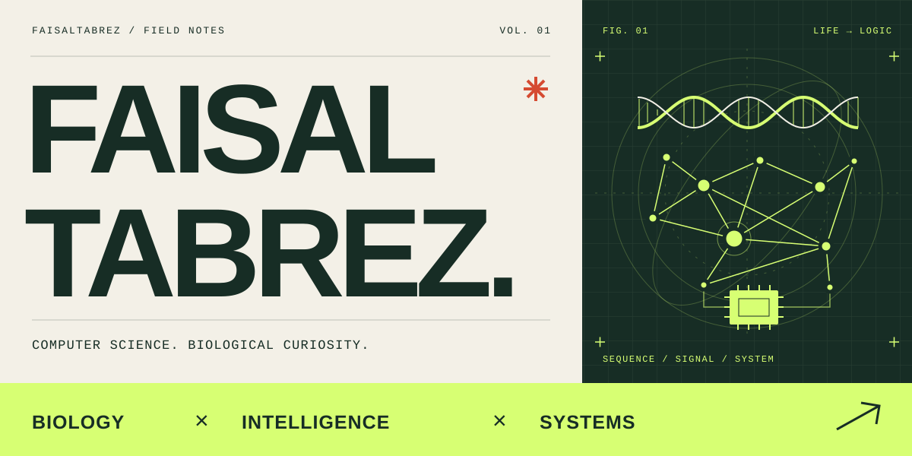
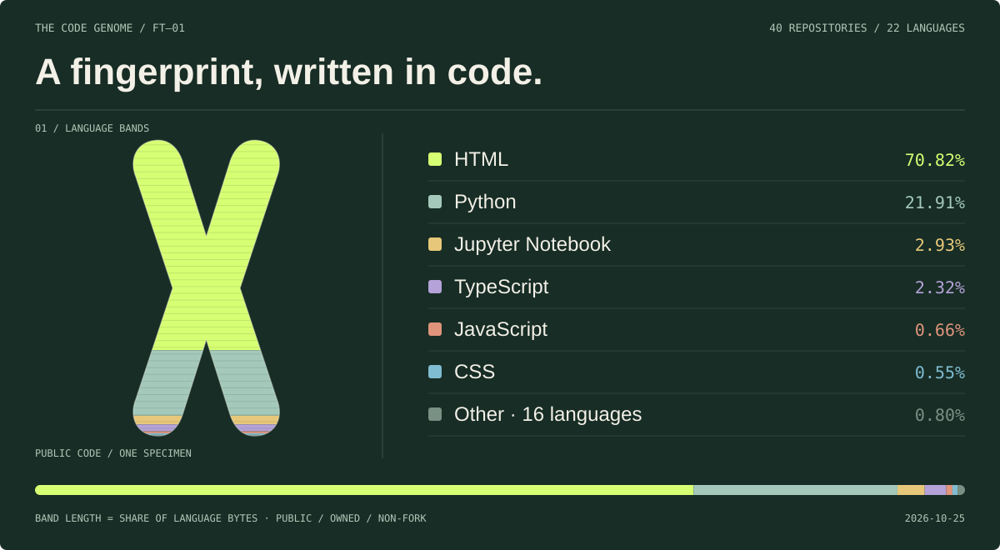
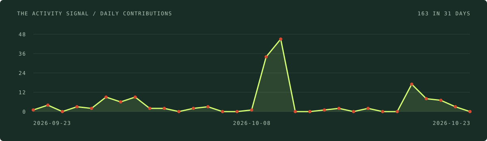
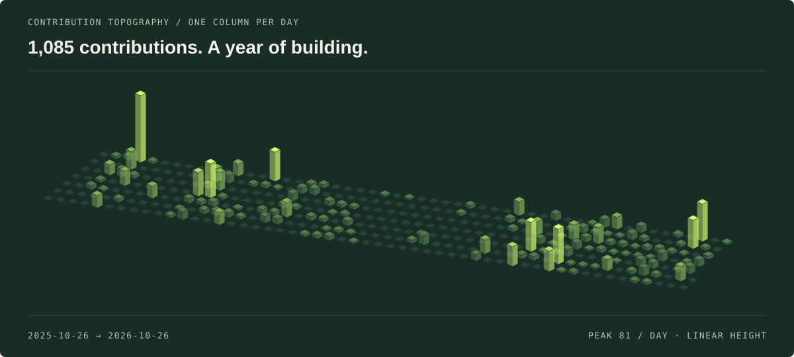
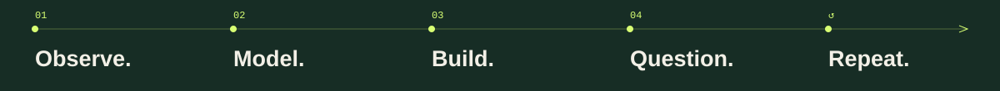

  

  

  <a href="#selected-work">Selected work</a> &nbsp; / &nbsp;
  <a href="#code-genome">Code genome</a> &nbsp; / &nbsp;
  <a href="#the-workbench">The workbench</a> &nbsp; / &nbsp;
  <a href="#github-in-motion">GitHub in motion</a> &nbsp; / &nbsp;
  <a href="https://github.com/FaisalTabrez?tab=repositories">All repositories</a> &nbsp; / &nbsp;
  <a href="mailto:mfaisaltabrez_cse230535@mgit.ac.in">Get in touch ↗</a>

  
  
  
  

 

### Computer science. Biological curiosity.

I'm **Md. Faisal Tabrez**, a **B.Tech student in Computer Science and Engineering (CSE)** based in **Hyderabad, India**, with a strong interest in **bioinformatics**. I explore genomic data science, machine learning, and systems programming—turning interesting questions into computational experiments and building the tools to investigate them.

My interests run from **environmental DNA and microbial networks** to **spiking neural networks, offline AI, and edge computing**. The common thread: understanding the signal, questioning the model, and making the system work.

 

## Code genome

One chromosome, many languages. The bands trace the language bytes across my public, owned, non-fork repositories.

  <picture>
    <source media="(max-width: 600px)" srcset="./assets/generated/code-genome-mobile.svg" />
    
  </picture>

Repository composition · refreshed daily · <a href="./assets/generated/code-genome.json">View the data ↗</a>

 

## Selected work

<table>
  <tr>
    <td width="50%" valign="top">
      01 / GENOMIC DISCOVERY
      <h3><a href="https://github.com/FaisalTabrez/Expedia">EXPEDIA ↗</a></h3>
      
An offline Windows workspace for exploring deep-sea environmental DNA through genomic embeddings and vector search.

      
<code>PyTorch</code> <code>LanceDB</code> <code>WinUI 3</code>

      Sequence → representation → discovery
    </td>
    <td width="50%" valign="top">
      02 / ADAPTIVE INTELLIGENCE
      <h3><a href="https://github.com/FaisalTabrez/A-SNN">A-SNN / AMMC ↗</a></h3>
      
An exploratory spiking-neural-network research workspace with a visual browser sandbox, tensor experiments, and documented causal audits.

      
<code>Python</code> <code>JavaScript</code> <code>Research tooling</code>

      Hypothesis → experiment → evidence
    </td>
  </tr>
  <tr>
    <td width="50%" valign="top">
      03 / COMPUTATIONAL BIOLOGY
      <h3><a href="https://github.com/FaisalTabrez/LUAD_Perceptron_v2">LUAD Cellular Perceptron ↗</a></h3>
      
An in silico research pipeline exploring miRNA biomarkers, cellular logic gates, RNA sensor design, and biophysical simulation.

      
<code>Python</code> <code>Scanpy</code> <code>SciPy</code>

      Biomarker → logic → simulation
    </td>
    <td width="50%" valign="top">
      04 / MICROBIAL ECOLOGY
      <h3><a href="https://github.com/FaisalTabrez/MicroNet">MicroNet ↗</a></h3>
      
Reconstructing microbial ecological networks from metagenomics through co-occurrence analysis, Bayesian inference, and graph neural networks.

      
<code>Python</code> <code>R</code> <code>Snakemake</code>

      Community → interaction → network
    </td>
  </tr>
</table>

  <a href="https://github.com/FaisalTabrez?tab=repositories">Explore the rest of the lab ↗</a>

 

## The workbench

  

| Layer | What I work with |
| :--- | :--- |
| **Languages** | Python · C++ · C · Bash · JavaScript |
| **Models & data** | PyTorch · NumPy · Pandas · Jupyter · genomic embeddings |
| **Search & local AI** | FAISS · LanceDB · llama.cpp · offline RAG |
| **Systems & hardware** | Linux · CMake · Docker · NVIDIA Jetson · Git |

 

## GitHub in motion

### The trophy cabinet

  

### By the numbers

  
  

  

### The activity signal

  

### A year in three dimensions

  

### Feeding the contribution snake

  <picture>
    <source media="(prefers-color-scheme: dark)" srcset="./assets/generated/snake-dark.svg" />
    <source media="(prefers-color-scheme: light)" srcset="./assets/generated/snake.svg" />
    
  </picture>

 

### A few questions that keep me building

- How much biological structure can we recover from a sequence representation?
- What would it take for an adaptive model to earn our trust?
- How much intelligence can we bring offline, onto smaller hardware?

 

  

  Interested in bioinformatics, research software, or local AI? 
  <a href="mailto:mfaisaltabrez_cse230535@mgit.ac.in"><strong>Let's compare notes ↗</strong></a>

